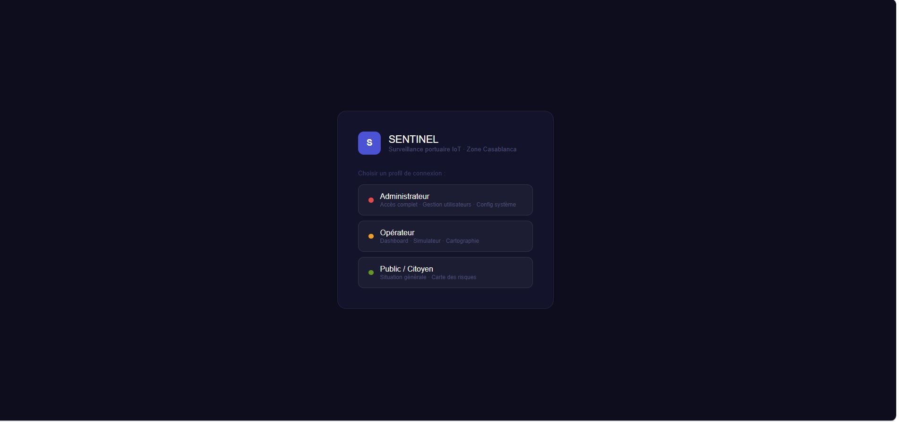
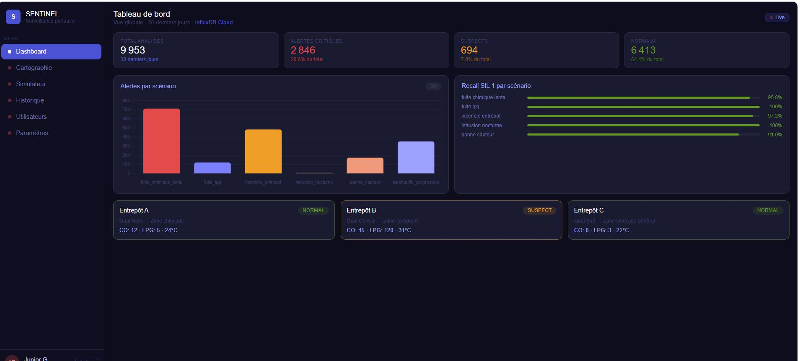
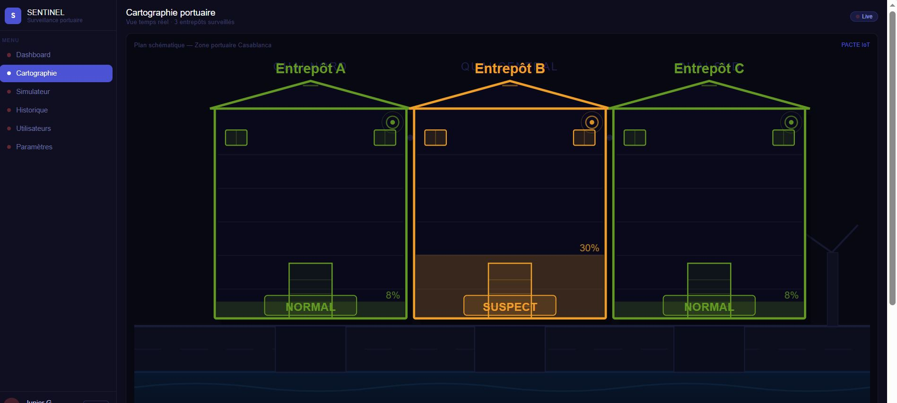
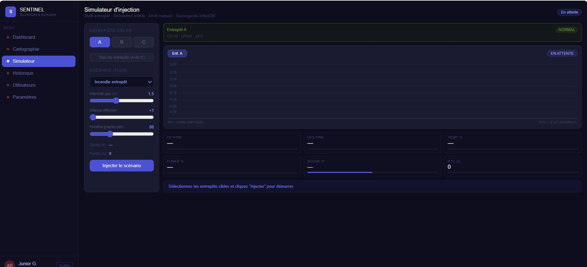
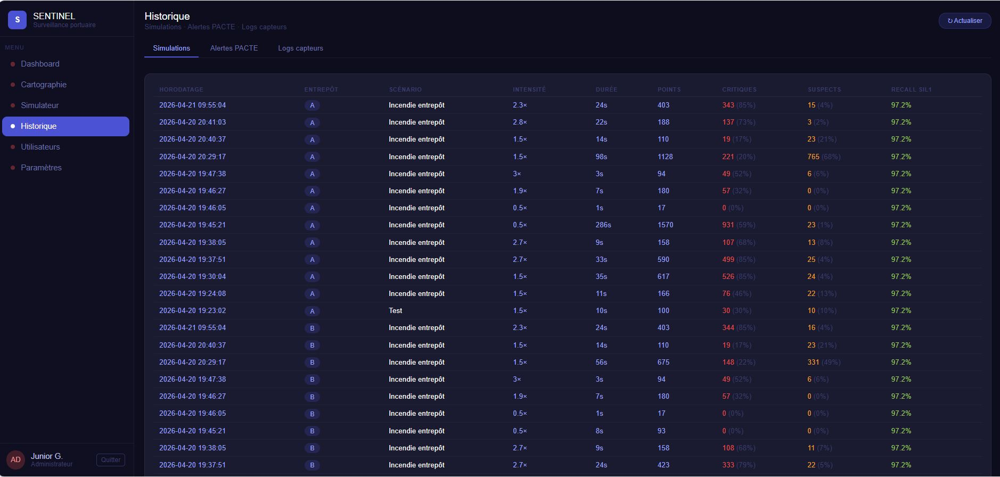
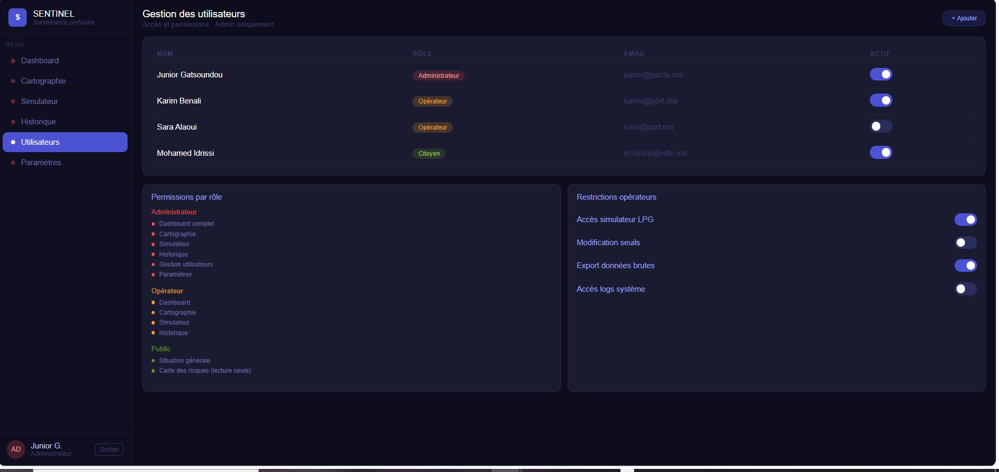
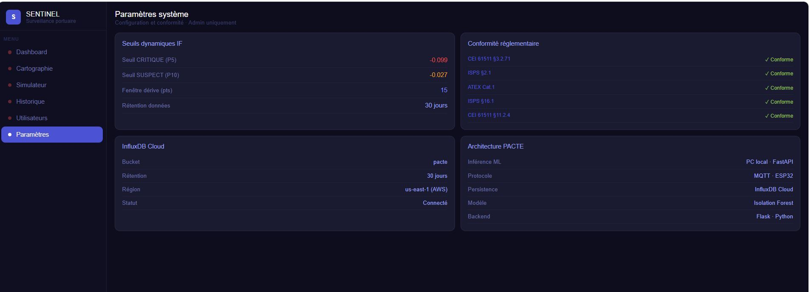

# SENTINEL — Système Intelligent de Détection d'Anomalies Portuaires

> Projet PACTE · 4ème année IA & Big Data · HESTIM Casablanca  
> Inspiré du Port of Rotterdam — Zone logistique Casablanca

[](https://python.org)
[](https://flask.palletsprojects.com)
[](https://cloud2.influxdata.com)
[]()
[]()

---

## Présentation

**SENTINEL** est un système de détection précoce d'anomalies environnementales dans des zones logistiques portuaires, développé dans un cadre académique avec des **capteurs et scénarios simulés**.

L'idée centrale : surveiller en continu 3 entrepôts portuaires via 9 capteurs IoT (CO, LPG, fumée, température, humidité, lumière, mouvement) et déclencher automatiquement des alertes dès qu'un comportement inhabituel est détecté — avant que la situation ne devienne dangereuse.

> Les capteurs ESP32 fonctionnent en mode simulation. Les 6 scénarios d'anomalies sont injectés synthétiquement dans un dataset réel (405 171 mesures Kaggle IoT Telemetry) pour entraîner et valider le modèle de détection, puis rejoués vers InfluxDB Cloud.

---

## Comment fonctionne le système ?

### 1. Collecte des données

Chaque entrepôt (A, B, C) est équipé d'un capteur **ESP32** qui relève toutes les N secondes : température, CO, LPG, fumée, humidité, lumière et mouvement. Ces données transitent via **MQTT** vers un **Raspberry Pi** qui joue le rôle de passerelle.

### 2. Détection des anomalies — Isolation Forest

Le modèle **Isolation Forest** (scikit-learn) analyse chaque mesure normalisée et lui attribue un **score d'anomalie** entre −1.0 et +0.5 :

- Une mesure **normale** est difficile à isoler → score proche de 0
- Une mesure **anormale** est facile à isoler → score très négatif

Deux seuils statistiques, calculés sur l'ensemble du dataset, classifient chaque mesure :

| Score | Classification | Seuil |
|---|---|---|
| `< −0.099` | 🔴 **CRITIQUE** | Percentile 5 (P5) |
| `−0.099 → −0.027` | 🟡 **SUSPECT** | Percentile 10 (P10) |
| `> −0.027` | 🟢 **NORMAL** | — |

### 3. Stockage et persistance

Les scores et alertes sont envoyés vers **InfluxDB Cloud** (base de données time-series) dans 3 measurements :
- `sensor_events` : toutes les mesures capteurs
- `critical_alerts` : uniquement les alertes CRITIQUE et SUSPECT
- `simulations` : résultats des scénarios injectés

### 4. Visualisation — Dashboard Flask

Un dashboard web en **Flask** permet de consulter en temps réel l'état des entrepôts, lancer des simulations, consulter l'historique et gérer les accès utilisateurs.

---

## Le Dashboard en images

### Connexion — Sélection du profil

L'accès au système est protégé par un système d'authentification avec **3 profils de rôles**. Chaque profil donne accès à des fonctionnalités différentes selon les responsabilités de l'utilisateur.



---

### Tableau de bord principal (Admin)

Vue globale sur les **30 derniers jours** : nombre total d'analyses, alertes critiques, suspects, normaux. Un graphique montre la répartition des alertes par scénario simulé. À droite, le recall SIL 1 est affiché en temps réel pour chaque scénario. En bas, l'état instantané de chaque entrepôt avec les valeurs capteurs (CO, LPG, température).



---

### Cartographie portuaire

Représentation schématique des 3 entrepôts en plan 2D. Chaque entrepôt affiche son **niveau de risque en couleur** (vert = NORMAL, orange = SUSPECT, rouge = CRITIQUE) et son pourcentage d'anomalies en cours. La cartographie se met à jour automatiquement selon les données InfluxDB.



---

### Simulateur d'injection

Outil central du projet. Permet de choisir un scénario d'anomalie (Incendie, Fuite LPG, Intrusion nocturne…), de paramétrer son intensité et sa vitesse de diffusion, puis de l'**injecter dans un ou plusieurs entrepôts**. Le graphe affiche en temps réel le score Isolation Forest qui évolue au fil de l'injection, avec les seuils P5 et P10 visibles.



---

### Historique des simulations

Journal complet de toutes les simulations lancées : horodatage, entrepôt cible, scénario, intensité, durée, nombre de points générés, nombre de critiques et suspects détectés, et le **recall SIL 1** obtenu pour chaque run. Permet de tracer les performances du modèle dans le temps.



---

### Gestion des utilisateurs (Admin uniquement)

Interface de gestion RBAC (**Role-Based Access Control**). L'administrateur voit la liste des utilisateurs, leur rôle et leur statut. Il peut également configurer finement les permissions par rôle : accès au simulateur LPG, modification des seuils, export des données brutes, accès aux logs système.



---

### Paramètres système (Admin uniquement)

Tableau de bord de configuration : seuils dynamiques de l'Isolation Forest (P5 et P10), statut de la connexion InfluxDB Cloud, et panneau de **conformité réglementaire** affichant l'état de conformité aux normes IEC 61511, ISPS et ATEX. L'architecture complète du système PACTE est aussi résumée ici.



---

## Les 6 scénarios d'anomalies simulés

Chaque scénario modifie les valeurs capteurs de manière réaliste pour reproduire une situation dangereuse :

| # | Scénario | Capteurs affectés | Risque |
|---|---|---|---|
| 1 | **Incendie entrepôt** | Fumée ↑↑, Temp ↑↑, CO ↑ | Critique |
| 2 | **Fuite LPG** | LPG ↑↑, CO ↑ | Critique |
| 3 | **Surchauffe progressive** | Temp ↑ (lente), Humidité ↓ | Suspect → Critique |
| 4 | **Fuite chimique lente** | CO ↑ (lent), LPG ↑ | Suspect |
| 5 | **Intrusion nocturne** | Motion actif, Lumière ↑ (nuit) | Critique |
| 6 | **Panne capteur (flatline)** | Valeurs fixes / nulles | Suspect |

---

## Performances — Conformité IEC 61511 SIL 1

La norme **IEC 61511 SIL 1** exige un recall ≥ 90% pour les systèmes de sécurité industriels. SENTINEL dépasse ce seuil sur tous les scénarios :

| Scénario | Recall | Statut |
|---|---|---|
| Fuite LPG | 100.0% | ✅ |
| Intrusion nocturne | 100.0% | ✅ |
| Incendie entrepôt | 97.2% | ✅ |
| Fuite chimique lente | 95.8% | ✅ |
| Panne capteur | 91.0% | ✅ |
| **Moyenne** | **96.8%** | **✅ SIL 1 atteint** |

---

## Contrôle d'accès (RBAC)

| Fonctionnalité | Administrateur | Opérateur | Public |
|---|:---:|:---:|:---:|
| Dashboard complet | ✅ | ✅ | — |
| Cartographie | ✅ | ✅ | ✅ (lecture) |
| Simulateur | ✅ | ✅ | — |
| Historique | ✅ | ✅ | — |
| Gestion utilisateurs | ✅ | — | — |
| Paramètres système | ✅ | — | — |
| Modification seuils | ✅ | — | — |

---

## Stack Technique

| Couche | Technologie |
|---|---|
| Dashboard | Flask (Python) |
| Base de données | InfluxDB Cloud (TSM engine, Flux query language) |
| ML | Isolation Forest — scikit-learn (`n_estimators=100`, `contamination=0.1`) |
| Normalisation | StandardScaler (mean=0, std=1) |
| Protocole IoT | MQTT → Raspberry Pi |
| Capteurs | ESP32 (mode simulation) |

---

## Installation

### 1. Cloner le dépôt

```bash
git clone https://github.com/gatsoundoujuniior-netizen/-sentinel-pacte.git
cd -sentinel-pacte
```

### 2. Environnement virtuel

```bash
python -m venv .venv
# Windows
.venv\Scripts\activate
# Linux/macOS
source .venv/bin/activate

pip install -r requirements.txt
```

### 3. Configuration InfluxDB

```bash
cp .env.example .env
# Éditez .env avec vos credentials InfluxDB Cloud
```

### 4. Dataset

Le dataset principal (`pacte_risk_log.csv` — 405 171 lignes, 29 MB) n'est pas inclus.  
**Téléchargement :** [Kaggle — IoT Telemetry Dataset](https://www.kaggle.com/datasets/garystafford/environmental-sensor-telemetry-data)  
Placez le fichier dans `data/pacte_risk_log.csv`.

### 5. Lancer le dashboard

```bash
python app.py
# Ouvrez http://localhost:5000
```

---

## Structure du projet

```
sentinel-pacte/
├── app.py                                  # Backend Flask (routes + API InfluxDB)
├── requirements.txt                        # Dépendances Python
├── .env.example                            # Template de configuration
│
├── notebooks/
│   └── pacte.ipynb                         # Notebook ML — entraînement, injection scénarios, validation SIL 1
│
├── scripts/
│   ├── query_influxdb.py                   # Requêtes Flux vers InfluxDB
│   ├── validate_scoring.py                 # Validation recall par scénario
│   └── ...                                 # Scripts d'injection notebook
│
├── design_app/
│   └── sentinel_full_rbac_port.html        # Dashboard complet (RBAC, visualisations)
│
├── assets/                                 # Diagrammes SVG
│   ├── architecture_sentinel.svg
│   ├── software_architecture.svg
│   ├── pipeline_donnees.svg
│   ├── scoring_seuils.svg
│   └── distribution_risques.svg
│
├── photo/                                  # Captures d'écran du système
│
├── data/
│   └── pacte_alertes_critiques.csv         # 57 213 alertes critiques exportées
│
└── docs/
    ├── SENTINEL_Documentation_Technique.html
    ├── Livrables 1.pdf                     # Livrable académique — Phase 1
    ├── Livrable 2.pdf                      # Livrable académique — Phase 2
    ├── PACTE_Architecture_UML.pdf
    └── PACTE_Sequence_Activite_UML.pdf
```

---

## Normes appliquées

| Norme | Niveau | Application |
|---|---|---|
| **IEC 61511** | SIL 1 | Seuils P5/P10, recall ≥ 90% validé sur 6 scénarios |
| **Code ISPS 2003** | Référence | Contexte sécurité portuaire |
| **Directive ATEX 2014/34/UE** | Référence | Scénarios LPG, fuite chimique, zones explosibles |
| **UML 2.5** | Conformité | Diagrammes classes, séquences, activités |

---

## Auteur

**Junior Stevy Gatsoundou**  
4ème année IA & Big Data — HESTIM Casablanca  
[gatsoundoujuniior@gmail.com](mailto:gatsoundoujuniior@gmail.com)

---

*Avril 2026 · Flask + InfluxDB Cloud + Isolation Forest*
